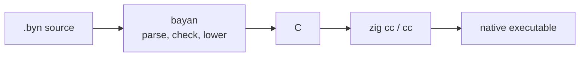
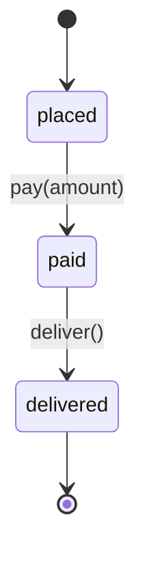

# Bayān

<p align="center">
  <picture>
    <source media="(prefers-color-scheme: dark)" srcset="docs/assets/brand/mascot/bayan-hoopoe-dark.svg">
    
  </picture>
</p>

A small, explicit language that compiles to native executables. Errors are values, memory is visible.

[](https://github.com/ikhbat-org/bayan/actions/workflows/ci.yml)
[](CHANGELOG.md)
[](#install)
[](#what-bayān-has-instead)
[](#memory-you-can-see)
[](LICENSE.md)

Bayān (بيان, "clear statement") compiles to a small native executable: no runtime, garbage collector or
exceptions. Values copy by default, errors are return values you must handle, and memory comes from
scopes and allocators you can see. The compiler, written in Bayān, lowers your program to C.

```swift
string greeting() {
    return "Salam, world!"
}

void main() {
    print(greeting())
}
```

```text
Salam, world!
```

A program starts at `void main()`; a file holding only `print("Salam, world!")` and no `main` also runs:
`bayan run hello.byn`.

> [!NOTE]
> Bayān is young (version 0.4.x): usable and self-hosting, but expect rough edges and changes between
> versions.

*Bayān (ASCII: Bayan). The CLI, package names, URLs and identifiers use `bayan`.*

---

## Contents

- [Install](#install)
- [Your first program](#your-first-program)
- [Batteries included](#batteries-included)
- [How it works](#how-it-works)
- [A taste of the language](#a-taste-of-the-language)
- [What Bayān has instead](#what-bayān-has-instead)
- [Where to go next](#where-to-go-next)
- [Working on the compiler](#working-on-the-compiler)
- [License](#license)

---

## Install

1. **Get `bayan`.** Download `bayan-<version>-<os>-<arch>.tar.gz` from the
   [releases page](https://github.com/ikhbat-org/bayan/releases) — `os` is `macos`, `linux` or `windows`,
   `arch` is `x64` or `arm64`, and Windows uses `.zip`. Unpack it and put `bayan` on your `PATH`:

   ```sh
   tar -xzf bayan-0.4.1-macos-arm64.tar.gz
   cp bayan-0.4.1-macos-arm64/bayan ~/.local/bin/
   ```

   On Windows, unzip and put `bayan.exe` on your `PATH`:

   ```powershell
   Expand-Archive bayan-0.4.1-windows-x64.zip -DestinationPath .
   $env:Path += ";$PWD\bayan-0.4.1-windows-x64"
   ```

2. **Get a C compiler.** Bayān prefers [zig](https://ziglang.org) (`zig cc`), which also builds for other
   platforms; without zig it uses `cc`, `clang` or `gcc` from `PATH`.

3. **Check your setup:**

   ```sh
   bayan doctor
   ```

   Lists the compiler, zig, git and build cache that `bayan` found, with a fix for each missing one.

---

## Your first program

```sh
bayan new greet
cd greet
bayan run
```

```text
Salam, world!
```

`bayan new` created a few files; three matter: `package.byn` (name, version, dependencies),
`src/app/main.byn` (the program) and `tests/app.test.byn` (a test).

Open `src/app/main.byn`:

```swift
/// The line this app prints.
string greeting() {
    return "Salam, world!"
}

print(greeting())
```

It has top-level statements and no `main`, so the compiler runs them. Change the greeting to
`"Salam, Aisha!"` and run `bayan run` again; `bayan test` fails until you change the expected greeting
too.

Save this as `guests.byn` outside the project: it fails with an error, and `@exitCode` sets the
process exit code:

```swift
union error GuestError {
    /// The guest list is empty.
    @exitCode(3)
    noGuests
}

i32 countGuests(string list) fails GuestError {
    fail .noGuests if list.isEmpty
    return 1
}

void main() fails GuestError {
    let guests = try countGuests("")
    print($"{guests} guests")
}
```

```sh
bayan run guests.byn; echo $?
```

```text
error: The guest list is empty.
3
```

`int` and `long` also compile; `bayan format` rewrites them to the spelling `style.primitives` in
`package.byn` sets (spec §3.1).

---

## Batteries included

One `bayan` binary holds the compiler, formatter, test runner and release builder; else only a C compiler
is needed. Commands come from `bayan --help`, except `bayan test --coverage`, which works but is not
listed there yet.

| Command | What it does |
|---|---|
| `bayan new`, `bayan init` | Create an app, library (`--lib`) or script (`--script`), new or existing directory |
| `bayan run` | Compile and run a project, script or file |
| `bayan build` | Compile to an executable; `--mode debug\|safe\|fast`, `--target`, `--emit-c` |
| `bayan test` | One process per test; `--coverage` (lines, branches, error paths); `--mutate` (mutation testing); `--changed` (modules touched since `HEAD`); `--json` |
| `bayan check` | Report diagnostics without building; `--diagnostics json` for tools |
| `bayan format` | Rewrite input forms and apply the `style` in `package.byn`; `--check` writes nothing |
| `bayan explain` | Explain a diagnostic code, for example `bayan explain BYN6002` |
| `bayan doctor` | Check the C compiler, zig, git and build cache, with a fix for each problem |
| `bayan dist` | Build release binaries into `dist/<version>/`; `--target all` cross-compiles through zig |
| `bayan mutate` | Run a command once per mutant site of a prebuilt `--mutate` binary |
| `bayan audit` | List every `because` bypass and `unsafe` or `extern` declaration, with its reason |
| `bayan clean`, `bayan cache stats` | Remove `out/` (and `dist/`, the cache on request); show the shared build cache |
| `bayan lex`, `types`, `features --used <path>` | Tokens, inferred types and features a build used |

`bayan-lsp`, an early language server with a VS Code extension, is in
[`editors/`](editors/README.md); each release archive holds it beside `bayan` (`bayan-lsp.exe` on Windows).

The standard library is compiled in, so no package manager is needed:

| Piece | What it gives you |
|---|---|
| `Io` | Files (`Io.readText`), standard streams, processes, random numbers; each use appears in `uses` |
| `Path` | File names and paths, for example `Path.fileName` |
| `List`, `Map` | Growable collections that allocate from an allocator |
| `StrBuf` | A string builder for loops |
| `Arena` | Allocate many things, free them together |
| `std.json` | A JSON reader and `Json` value type: `import std.json` |

`std.time` and `std.db` are specified in [`docs/bayan-spec.md`](docs/bayan-spec.md) but not built yet.

---

## How it works

`bayan` parses and checks your `.byn` files, lowers them to C and hands it to `zig cc` (or `cc`); the
output is one native executable.



`bayan build --emit-c` prints the generated C; a project build keeps it in
`out/<mode>/<target>/c/main.c`.

---

## A taste of the language

Programs around a community iftar; each runs with `bayan run main.byn`.

### Errors are values

Booking can fail, and the signature says so (`fails BookingError`): the compiler checks that every caller
handles every error. An error can carry data, like `notEnough(i32 left)`.

```swift
union error BookingError {
    /// Every seat is taken.
    full
    /// Fewer seats are left than were asked for.
    notEnough(i32 left)
}

struct Iftar {
    i32 seats
    i32 booked

    i32 left => seats - booked

    void reserve(ref this, i32 count) fails BookingError {
        fail .full if left == 0
        fail .notEnough(left) if count > left
        booked += count
    }

    string book(ref this, string guest, for i32 count) {
        reserve(count) catch switch {
            .full => return $"Sorry {guest}, the iftar is full",
            .notEnough(let left) => return $"Sorry {guest}, only {left} left",
        }
        return $"{guest} booked {count}, {left} left"
    }
}

void main() {
    var iftar = Iftar { seats: 6, booked: 0 }
    print(iftar.book("Umar", for: 2))
    print(iftar.book("Aisha", for: 3))
    print(iftar.book("Bilal", for: 4))
    print(iftar.book("Yusuf", for: 1))
    print(iftar.book("Maryam", for: 1))
}
```

```text
Umar booked 2, 4 left
Aisha booked 3, 1 left
Sorry Bilal, only 1 left
Yusuf booked 1, 0 left
Sorry Maryam, the iftar is full
```

`///` is a doc comment; on an error case its first line is the error's message, so `$"{e}"` prints
`Every seat is taken.`. A plain `//` comment, even trailing, is not part of the program. `fail` returns
the error; a failing call is `try` (pass it on) or `catch` (handle it here).

### Effects are part of the signature

A public function lists what it touches: files (`fs`), memory (`alloc`), the console, the network and so
on; with no `uses` clause it only computes. Private functions, `main` and scripts infer their effects.

```swift
/// Counts the names in a guest list, one per line. No `uses` clause: it only computes.
public i32 countGuests(string list) {
    var count = 0
    for line in list.lines {
        count += 1 if !line.trimmed().isEmpty
    }
    return count
}

/// Reads the guest list from a file, so it declares `uses fs`.
public i32 guestsIn(string path) uses fs, alloc fails IoError {
    let list = try Io.readText(path)
    return countGuests(list)
}

void main() {
    let guests = guestsIn("guests.txt") catch {
        print("No guest list yet")
        return
    }
    print($"{guests} guests, {guests * 3} dates to break the fast")
}
```

With a `guests.txt` of three names:

```text
3 guests, 9 dates to break the fast
```

Without the file it prints `No guest list yet`. Leaving `alloc` out of `uses` gets a compiler error with
the fix:

<details>
<summary>The compiler error</summary>

```text
error BYN6002: `guestsIn` uses `alloc` but does not declare it
  --> ~/iftar/main.byn:12:20

  12 │     let list = try Io.readText(path)
     │                    ^^^^^^^^^^^^^^^^^ uses `alloc`
     │
  help: add `alloc` to the `uses` clause, or remove the call
     │ 11 │ public i32 guestsIn(string path) uses fs, alloc fails IoError {
     │    │                                         +++++++

✗ build failed: 1 error, 0 warnings
  explain: bayan explain BYN6002
```

</details>

### States the compiler tracks

An order moves placed → paid → delivered. Each method names the state it needs (`is .paid`) and the one it
leaves (`becomes .delivered`); a state can carry data (`paid(i32 amount)`).



```swift
struct Order {
    string dish
    i32 plates
    states {
        placed
        paid(i32 amount)
        delivered(i32 amount)
    }

    void pay(ref this is .placed, i32 amount) becomes .paid {
        become .paid(amount)
    }

    void deliver(ref this is .paid) becomes .delivered {
        become .delivered(amount)
    }
}

string status(Order o) => o switch {
    .placed => $"{o.plates} plates of {o.dish}, waiting for payment",
    .paid(let amount) => $"{o.dish} paid ({amount}), on its way",
    .delivered => $"{o.dish} delivered",
}

void main() {
    var order = Order.placed { dish: "lentil soup", plates: 40 }
    print(status(order))
    order.pay(120)
    print(status(order))
    order.deliver()
    print(status(order))
}
```

```text
40 plates of lentil soup, waiting for payment
lentil soup paid (120), on its way
lentil soup delivered
```

Deliver before paying (drop `order.pay(120)`) and it does not compile:

<details>
<summary>The compiler error</summary>

```text
error BYN7001: `deliver` needs `order` to be `.paid`, but it is `Order.placed`
  --> ~/iftar/main.byn:29:5

  29 │     order.deliver()
     │     ^^^^^
     │
  help: check the state with `is` or `switch` first

✗ build failed: 1 error, 0 warnings
  explain: bayan explain BYN7001
```

</details>

### Memory you can see

Text and lists come from an allocator, and `provide` picks which; here one arena holds every invitation
and frees them together at scope end.

```swift
void main() {
    let guests = ["Umar", "Aisha", "Bilal"]
    using let arena = Arena()
    provide allocator: arena {
        for guest in guests {
            let card = $"Assalamu alaykum {guest}, join us for iftar on Friday"
            print(card)
        }
    }
}
```

```text
Assalamu alaykum Umar, join us for iftar on Friday
Assalamu alaykum Aisha, join us for iftar on Friday
Assalamu alaykum Bilal, join us for iftar on Friday
```

### A few more things

- **Particles.** At most one parameter is unlabeled; the rest carry a word such as `for`, said at the
  call: `iftar.book("Umar", for: 2)`, so arguments can't swap.
- **Locals** are `let` or `var`: `let list = …` or `let list: string = …`. Declarations put the type
  first (`i32 countGuests(…)`), local bindings the name first; the reverse shows the fix in the error.
- **`stmt if condition`** guards a statement: `fail .full if left == 0`.
- **Errors teach.** Each has a code; `bayan explain BYN1043` explains it.

---

## What Bayān has instead

| Often found elsewhere | In Bayān |
|---|---|
| Exceptions | `fails` in the signature; `fail` returns the error; `try` and `catch` at the call |
| Garbage collector | Scopes and allocators; `Arena` and `provide allocator:` |
| Runtime to install | None; the output is one native executable |
| Hidden side effects | `uses` clauses on public functions |
| Run-time lifecycle checks | `states`, `is` and `becomes`, checked at compile time |

---

## Where to go next

- `bayan --help` lists every command.
- Full language reference: [`docs/bayan-spec.md`](docs/bayan-spec.md).
- Naming: [grammar guide](docs/bayan-grammar.md). Style: [style guide](docs/bayan-style.md).
- Every error and warning: [`docs/DIAGNOSTICS.md`](docs/DIAGNOSTICS.md). Changes per version:
  [`CHANGELOG.md`](CHANGELOG.md).
- Next: [`docs/bayan-roadmap.md`](docs/bayan-roadmap.md). Not planned:
  [`docs/bayan-not-planned.md`](docs/bayan-not-planned.md). No slot yet:
  [`docs/bayan-nice-to-have.md`](docs/bayan-nice-to-have.md).
- Home <https://bayan.run>; repository <https://github.com/ikhbat-org/bayan> (Ikhbat Foundation).

Found a bug or a confusing error message? Open an issue with a small program that shows it.

---

## Working on the compiler

The compiler is in `src/`, written in Bayān; you need a C compiler (zig is optional).

Build the self-hosted `bayan` with any `bayan`, or with only a C compiler from `bootstrap/bayan.c` (the
self-hosted compiler as plain C); see [`bootstrap/README.md`](bootstrap/README.md).

```sh
bayan build --mode safe --package src -o tmp/bayan-selfhost src/driver
cc -std=c11 -O2 -DBYN_NDEBUG -fwrapv -ffp-contract=off bootstrap/bayan.c bootstrap/bayan-rt.c -lm -o tmp/bayan-boot
./tmp/bayan-selfhost --version                 # bayan <version> (selfhost)
```

`bash scripts/test.sh` runs the suite (golden cases, `test` blocks, CLI parity, script tests, runtime C
tests); `--only <part>` runs one part.

Local builds go in `dist/` (gitignored); `scripts/dist.sh` writes `dist/<target>/<version>/` plus a
per-target `latest/` that every build replaces, while `bayan dist` writes `dist/<version>/` and one
`dist/latest/`.

```sh
scripts/dist.sh                                # this host: dist/macos-arm64/0.4.1/bayan
scripts/dist.sh --from <publish-dir> --rid win-x64 --commit <sha>   # import a binary published on another OS
```

`--rid <rid>` cross-builds another target through zig; `--from` imports a binary built elsewhere.

Milestones and a doc index: [`docs/bayan-milestones.md`](docs/bayan-milestones.md). Progress log:
[`docs/bayan-progress-log.md`](docs/bayan-progress-log.md). Cutting a version:
[`docs/RELEASING.md`](docs/RELEASING.md).

Code fences in this README use Swift highlighting until GitHub knows `.byn`.

---

## License

Bayān is released under the Islamic Software License - Permissive (ISL-P), Version 1.2; see
[`LICENSE.md`](LICENSE.md).
