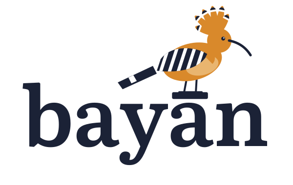

# The Bayān Manifesto

*Syntax is a contract. Ten axioms for a language that says what it means, explained for developers who have never written Bayān or studied Arabic.*

Version: 0.3.2 (matches `bayan --version`)

Edition 1 · November 2026 · written against the Bayān specification at commit 8d5e5c71 (revisions 0001–0019) and compiler 0.2.0

---

## Contents

- [How to read this book](#how-to-read-this-book)
- [Bayān in two minutes](#bayān-in-two-minutes)
- [Why Arabic grammar?](#why-arabic-grammar)
- [The manifesto](#the-manifesto)
- [Axiom I: Morphological predictability](#axiom-i-morphological-predictability)
- [Axiom II: State is a law](#axiom-ii-state-is-a-law)
- [Axiom III: Explicit exception and purpose](#axiom-iii-explicit-exception-and-purpose)
- [Axiom IV: The cadence of execution](#axiom-iv-the-cadence-of-execution)
- [Axiom V: Roles, not positions](#axiom-v-roles-not-positions)
- [Axiom VI: Head first](#axiom-vi-head-first)
- [Axiom VII: One spelling, free composition](#axiom-vii-one-spelling-free-composition)
- [Axiom VIII: Nothing hidden](#axiom-viii-nothing-hidden)
- [Axiom IX: Valid by construction](#axiom-ix-valid-by-construction)
- [Axiom X: The hoopoe's voice](#axiom-x-the-hoopoes-voice)
- [Epilogue: joy is a requirement](#epilogue-joy-is-a-requirement)
- [Appendix A: glossary](#appendix-a-glossary)
- [Appendix B: cheat sheet](#appendix-b-cheat-sheet)
- [Appendix C: status at the time of writing](#appendix-c-status-at-the-time-of-writing)
- [Appendix D: from the first draft to this edition](#appendix-d-from-the-first-draft-to-this-edition)


# How to read this book

This is a manifesto with receipts. Each axiom says what Bayān believes, shows the problem in languages you already know, then shows the Bayān code and the compiler check that enforces it.

You need no Arabic. Every Arabic word comes with its sound, its meaning, and an everyday example. You need no Bayān either. If you have written C#, Java, Swift, Rust, TypeScript or Go, you can read every example.

Each feature carries a status badge, so you know what you can use today:

| Badge | Meaning |
|---|---|
| `built` | In the compiler (0.2.x), with tests |
| `partial` | Some forms work, others are still to come |
| `planned` | In the specification, not yet in the compiler |

Code labelled **Bayān** is Bayān. Code labelled with another language is shown for comparison and is written the way that language's own community writes it. A red ✗ tag marks code the Bayān compiler rejects on purpose.

# Bayān in two minutes

Bayān (بيان, *bayān*, "clarity, eloquent exposition") is a natively compiled systems language with a C-family surface. It compiles through C to native executables and WebAssembly. It aims for Rust and Zig speed without their punctuation.

| What it has | What it does not have |
|---|---|
| Value types (structs) only | No classes, no inheritance, no `object` |
| Stack, arenas and owned heap memory | No garbage collector, no runtime |
| Errors as values: `fails`, `try`, `catch` | No exceptions |
| Effects in signatures: `uses net, alloc` | No hidden I/O or allocation |
| Newlines end statements | No semicolons |

Here is a complete feature, a typestate transition that talks to the network and can fail, in six lines:

*Bayān*

```csharp
public void pay(ref this is .placed, Payment p)
    uses net becomes .paid fails PaymentError
{
    let id = try p.charge(total)
    become .paid(payment: id)
}
```

Read the signature aloud: *pay, acting on this order while it is placed, using the network; it becomes paid, or fails with a payment error.* Every word in that sentence is checked by the compiler. That is the whole idea of this book.

> **Hello, world** in Bayān is one line: `print("Hello, world!")`. No class, no `static void Main`, no semicolon.

# Why Arabic grammar?

Most Arabic words are built from two parts: a **root** of three consonants that carries the meaning, and a **pattern** (*wazn*) that carries the role. The root ك ت ب (k-t-b) means *writing*. Pour it into different patterns and you get a family of words whose meaning you can predict before you have ever seen them.

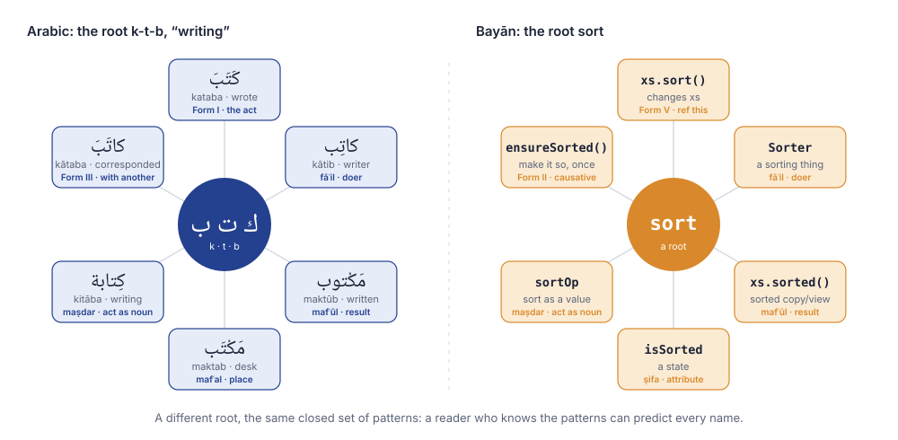

Arabic grammarians described these rules as a closed system more than twelve centuries ago. Sībawayh's *al-Kitāb* (8th century) treats the language as rules with predictable outputs. A compiler wants that: a small set of rules, applied the same way every time, with nothing left to guess.

Bayān borrows **rules**, not script or word order. Bayān code reads left to right, in English words. Arabic appears only in documentation and in `bayan explain`, where a diagnostic tells you where its rule comes from. The compiler's messages are plain English.

Not every axiom has an Arabic source. Where a rule is Bayān's own idea, this book says so.

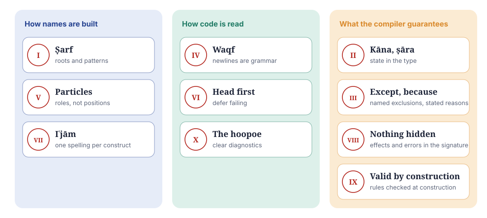

# The manifesto

## Syntax is a contract

Bayān is not a decorative layer over C syntax. It is a systems language built on one premise: the rigor of classical Arabic grammar can be mapped onto memory safety, predictable structure and compiler design. When grammar is strict, the compiler does the work, and the programmer's intent is never ambiguous.

**I. Morphological predictability** *(ṣarf)*. Names are structure, not style. A small closed set of patterns derives every form of an action. The shape of a name tells you whether it changes memory, makes a copy, can fail, or writes into your buffer.

**II. State is a law** *(kāna, ṣāra)*. A value's lifecycle lives in its type. What it *was* and what it *became* are checked when you compile, not when you run.

**III. Explicit exception and purpose** *(istithnāʾ, mafʿūl li-ajlihi)*. What you leave out is named with `except`. Every bypass of a safety rule states its reason with `because`, and the reasons can be audited.

**IV. The cadence of execution** *(waqf)*. There are no semicolons. A newline ends a statement; a small, fixed set of marks keeps it open. Every misread line becomes a compile error.

**V. Roles, not positions** *(ḥurūf al-jarr)*. Arguments are labelled by their role with a closed set of eight particles. A call reads as a sentence, and swapped arguments become label errors.

**VI. Head first** *(taqdīm, ḥāl)*. The head of a construct comes first and its circumstances follow: `struct unique`, `defer failing`.

**VII. One spelling, free composition** *(iʿjām, ḥadhf)*. One spelling per construct. Familiar alternatives are rewritten by the formatter. Different sentences built from the same grammar are welcome; synonyms are not.

**VIII. Nothing hidden** *(bayān)*. A signature says what a function needs, what it touches, what it becomes, and how it fails. Allocation, I/O, suspension and failure are never invisible.

**IX. Valid by construction.** A value that exists is a valid value. Rules live in the type, are checked when the value is built, and are the only way to clean untrusted input.

**X. The hoopoe's voice** *(hudhud)*. The compiler speaks like the hoopoe in the Qurʾān: certain, specific, useful. What went wrong, where, why, and how to fix it.

# Axiom I: Morphological predictability

> **صَرْف** · *ṣarf* · morphology: how words are built from roots and patterns

> The shape of a name tells you what the call does to memory. You should never have to look up whether `sort` changes your list or hands you a new one.

## The idea, without Arabic

Think of English *-ed*: *sort* is something you do, *sorted* is the result. Arabic takes this idea much further and makes it regular. A root is poured into a pattern, and the pattern decides the role:

| Pattern | Arabic example | Role | Bayān pattern |
|---|---|---|---|
| Form I | كَتَبَ *kataba*, "he wrote" | The plain act | `x()` |
| Form V | تَعَلَّمَ *taʿallama*, "he learned" (made himself learn) | The act turned back on oneself | `x(ref this)` |
| *mafʿūl* | مَكْتوب *maktūb*, "written" | The result of the act | `xed()` |
| Form X | اِسْتَغْفَرَ *istaghfara*, "he sought forgiveness" | Seeking, attempting | `tryX()` |
| Form II | عَلَّمَ *ʿallama*, "he made someone know" | Causing | `ensureX()` |
| Form III | كاتَبَ *kātaba*, "he wrote back and forth with" | Acting with another | `xWith(other)` |
| *ilā* (إلى) | "into, toward" | Destination | `xInto(ref dst)` |
| *maṣdar* | كِتابة *kitāba*, "the act of writing" | The act as a thing | `xOp` |
| *fāʿil* | كاتِب *kātib*, "writer" | The one who does it | `T.Builder`, `Parser` |

In Bayān, **every type is a root**. You may create as many roots as you like. You may never invent a pattern: the set is closed, so every reader already knows them all.

## The problem elsewhere

Each mainstream language has a naming convention for "change it" versus "give me a changed copy". Few check it, and several break their own convention.

*JavaScript*

```javascript
const a = [3, 1, 2]
a.sort()           // changes a, and also returns it
a.toSorted()       // copy (ES2023): a new word shape
a.reverse()        // changes a
"  hi ".trim()     // copy: strings never change
```

*Python*

```python
xs.sort()          # changes xs, returns None
sorted(xs)         # copy, but a free function
xs.reverse()       # changes xs
reversed(xs)       # a lazy iterator, not a list
```

*C#*

```csharp
list.Sort();                  // changes list
list.OrderBy(x => x);         // lazy copy, a different verb
list.Reverse();               // changes a List<T>
seq.Reverse();                // on IEnumerable<T>: a new sequence
int.Parse(s);                 // throws on bad input
int.TryParse(s, out var n);   // bool plus an out parameter
```

*Rust*

```rust
v.sort();                          // &mut self: changes v
let s: Vec<_> = { let mut c = v.clone(); c.sort(); c };
let n = "42".parse::<i64>();       // Result<i64, ParseIntError>
let m = "42".parse::<i64>().ok();  // Option, through an adapter
```

Swift comes closest: its API guidelines ask for `sort()` and `sorted()`. Bayān takes that convention, makes it a closed grammar, and has the compiler check it.

## The Bayān way

*Bayān*

```csharp
var xs: List<i64> = [3, 1, 2]
xs.sort()                        // a verb on `ref this`: changes xs
let ys = xs.sorted()             // -ed: a sorted view or copy; xs is untouched

let price = try Money.parse(text)    // base form: fails with the reason
let maybe = Money.tryParse(text)     // Form X: Money?, null on failure

order.formatInto(ref buf)        // into: writes into the buffer you own
let s = order.format()           // the allocating form, derived from formatInto
```

You write the base forms. The compiler derives the rest and computes their costs:

*Bayān*

```csharp
public void sort(ref this) { … }                              // you write this
public static Money parse(string text) fails MoneyError       // and this
public void formatInto(ref StrBuf dst) { … }                  // and this

// derived when referenced:
//   Money.tryParse(text) -> Money?      keeps parse's effects
//   order.format()       -> string      adds `uses alloc`
//   Money.parseOp(text)                 the act as a value
```

Patterns compose in one fixed order, `[try] verb [Into] [Op]`: `tryFormatInto`, `parseOp`, `tryFormatIntoOp`.

## The pattern grid

Read a row as one root and a column as one pattern. Each cell is the name the grammar reserves for that combination; a library provides only the ones it needs. A dash means the pattern does not apply.

| Root | Act on itself | Changed copy | Attempt | Into a buffer | As a value | State | Doer |
|---|---|---|---|---|---|---|---|
| sort | `xs.sort()` | `xs.sorted()` | — | — | `sortOp` | `isSorted` | `Sorter` |
| parse | — | — | `tryParse` | — | `parseOp` | — | `Parser` |
| format | — | — | — | `formatInto` | `formatOp` | — | `Formatter` |
| trim | — (strings never change) | `s.trimmed()` | — | — | — | — | — |
| append | `xs.append(x)` | `xs.appended(x)` | — | — | — | `hasItems` | — |

## How to pick a name

The grammar guide gives a decision tree. Take the first question that answers yes.

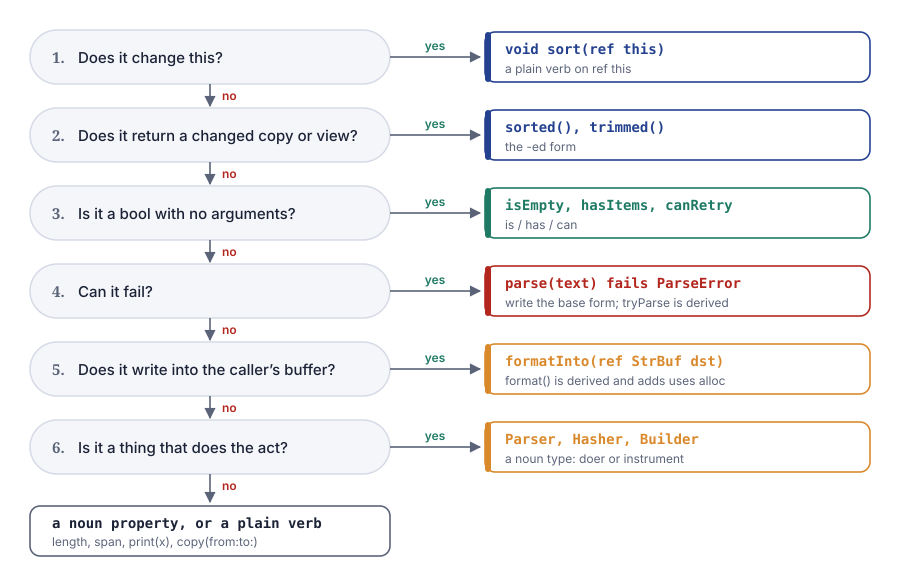

## What the compiler checks

| Code | When it fires | Message |
|---|---|---|
| BYN2115 | A member changes `this` without saying so | `push` modifies `this` but is not declared `ref this` |
| BYN2104 | A `ref this` member is called on a `let` | `xs` is immutable (fix: `var`) |
| BYN5001 | An `-ed` name changes `this` | `sorted` changes `this`; name it `sort` |
| BYN5003 | A hand-written `tryX` returns the wrong shape | `tryParse` must return `Money?` or `bool` |
| BYN5102 | A `bool` property lacks `is`/`has`/`can` | lint with a fix-it |

**Status:** Naming checks `built` · Derived `tryX`, `xInto` → `x()`, `xOp` `partial` (hand-written forms are checked; automatic derivation is coming)

> **Takeaway.** A name in Bayān is a promise about memory. `sort` changes, `sorted` copies, `tryX` hands back `null` instead of failing, `xInto` writes into the buffer you own. The compiler holds every name to its promise.

# Axiom II: State is a law

> **كانَ · صارَ** · *kāna, ṣāra* · “was” and “became”: the verbs of state

> An order that has not been paid cannot be shipped. In most languages that sentence is a comment or an `if`. In Bayān it is a type, and breaking it does not compile.

## The idea, without Arabic

In Arabic grammar, كانَ *kāna* ("was") and صارَ *ṣāra* ("became") are not ordinary verbs. They attach a state to a subject, and they change how the rest of the sentence is marked: the word describing the state takes a different grammatical case. Being and becoming are part of the grammar, not a remark beside it.

> صارَ الطلبُ مدفوعًا · *ṣāra ṭ-ṭalabu madfūʿan* · "the order became paid"

Bayān does the same with values. A struct declares its states once. `Order.paid` is a real type, written wherever a type can go. A method declares what state it needs and what state it leaves behind, and the compiler tracks the value through your code.

## The problem elsewhere

*C#*

```csharp
public void Ship(Carrier carrier) {
    if (State != OrderState.Paid)
        throw new InvalidOperationException("not paid");
    // ...
}

order.Ship(carrier);   // compiles; fails in production
```

*TypeScript*

```typescript
type Order =
  | { state: "placed"; id: string }
  | { state: "paid"; id: string; payment: string }

function ship(o: Order) {
  if (o.state !== "paid") throw new Error("not paid")
  // narrowed here, but calling a method never
  // changes what the caller's variable is known to be
}
```

*Rust*

```rust
struct Order<S> { id: OrderId, state: S }
struct Placed;
struct Paid { payment: PaymentId }

impl Order<Placed> {
    fn pay(self, p: &Payment) -> Result<Order<Paid>, PaymentError> {
        let id = p.charge(self.total())?;
        Ok(Order { id: self.id, state: Paid { payment: id } })
    }
}
```

Rust's typestate pattern gets the guarantee, at the price of one generic marker per state and a rebuild on every transition. TypeScript narrows inside a function but cannot carry a transition back to the caller. C# finds out at run time.

## The Bayān way

*Bayān*

```csharp
struct Order {
    OrderId id
    List<Line> lines

    states {
        draft
        placed
        paid(PaymentId payment)
        shipped(PaymentId payment, TrackingId tracking)
        cancelled(string reason)
    }
}

type Fulfilled = Order is .paid or .shipped

public void pay(ref this is .placed, Payment p)
    uses net becomes .paid fails PaymentError
{
    let id = try p.charge(total)
    become .paid(payment: id)
}

public Url trackingUrl(this is .shipped) => carrierUrl(tracking)
public Order.shipped ship(move Order.paid order, by Carrier carrier)
    uses net fails CarrierError
{ … }
```

`becomes .paid` is the *ṣāra*: the declared transition. `become .paid(…)` performs it. The caller's variable changes type as it goes:


*Bayān (rejected by the compiler)*

```csharp
var order = try cart.checkout()     // Order.placed
try order.pay(card)                 // now Order.paid
let url = order.trackingUrl()       // ✗ BYN7001
```

> `trackingUrl` needs `order` to be `.shipped`, but it is `Order.paid`

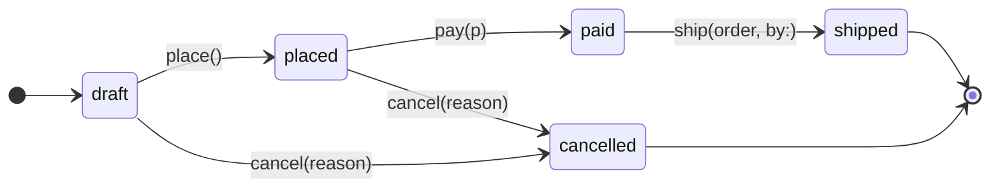

*The order lifecycle as declared by its states block. Each arrow is a method with a becomes clause, or a move into a new value.*

## The rules, briefly

1. `Order.paid` is a type: use it for parameters, returns, fields, locals and generics (`List<Order.paid>`).
2. Widening is free and implicit: `Order.paid` → `Fulfilled` → `Order`. Narrowing happens only through `is`, `switch`, or a `becomes` call.
3. A payload field is readable only where the state guarantees it: `payment` is readable on `Fulfilled`, `tracking` is not.
4. **A failed transition leaves the state unchanged.** A method that declares `becomes .s` must `become` on every path that returns normally.
5. A switch over states is exhaustive, so adding a state breaks every switch that forgot it, at compile time.
6. **Zero runtime cost.** `Order.paid` has the same layout as `Order` (a one-byte tag plus a payload union). Every check is erased before C is emitted.

## What the compiler checks

| Code | When it fires | Message |
|---|---|---|
| BYN7001 | A value in the wrong state | `trackingUrl` needs `order` to be `.shipped`, but it is `Order.paid` |
| BYN7002 | Reading a payload the state does not guarantee | `tracking` is a payload of `.shipped`; `o` is not known to be `.shipped` |
| BYN7003 | `become` without a matching `becomes` | `become` needs `becomes .paid` on `pay` |
| BYN7004 | A state switch misses a state | the switch does not handle state `.cancelled` |
| BYN7005 | A literal of a stateful struct names no state | `Order` has states; a literal must name one |
| BYN7009 | A `becomes` method can return without `become` | `pay` declares `becomes .paid` but returns here without `become` |

**Status:** Typestate (`states`, `becomes`, `become`, `T.s` types) `built`, with fourteen diagnostics

> **Takeaway.** In Bayān, "was" and "became" are grammar. The lifecycle you would have written in a comment is written in the type, checked at compile time, and costs nothing at run time.

# Axiom III: Explicit exception and purpose

> **إلّا · لِأَجْلِ** · *istithnāʾ, mafʿūl li-ajlihi* · the exception, and the object of purpose

> Ambiguity breeds bugs. What you leave out is named, never implied. When you step around a safety rule, you write down why, and the reason travels with the code.

## Part one: `except`

### The idea, without Arabic

Arabic grammar has a whole chapter on exception, *istithnāʾ*. The classic example:

> جاءَ القومُ إلّا زيدًا · *jāʾa l-qawmu illā Zaydan* · "the people came, except Zayd"

The sentence names the whole and then names what is subtracted. Nothing is filtered by a hidden condition. Bayān's `except` works the same way: it subtracts a **pattern** from a sequence, a set, or an error set.


### The problem elsewhere

*C#*

```csharp
var present = users.Where(u => u != null);
// still IEnumerable<User?>: the filter did not narrow the type
foreach (var u in present) Console.WriteLine(u!.Name);
```

*Kotlin*

```kotlin
val present = users.filterNotNull()
// List<User>: narrowed, but through a dedicated function
// that exists only for the null case
```

*Rust*

```rust
let present: Vec<User> = users.into_iter().flatten().collect();
// works because Option is iterable; the intent hides in `flatten`
```

Error sets have the same gap. Zig, Rust and Swift have no way to say "every error of this set except one"; you declare a new set by hand and keep it in sync.

### The Bayān way

*Bayān*

```csharp
let present = users except null                   // List of User, not User?
for line in order.lines except inactive { … }     // `inactive` is a named pattern
union error Retryable = CarrierError except .rejected
```

`except` takes **patterns only**, never conditions. A condition is a different job, and it already has a word:

*Bayān (rejected by the compiler)*

```csharp
let big = orders except o.total > 100     // ✗ BYN1052: takes a pattern
let big = orders.where(it.total <= 100)   // the job of `where`
```

`users except null` and `users.where(it is not null)` mean the same thing, narrow the same way and cost the same. Bayān allows both, because they are different sentences built from one grammar (Axiom VII).

## Part two: `because`

### The idea, without Arabic

The *mafʿūl li-ajlihi*, "the object for whose sake", is a noun that states the purpose of an act:

> قُمْتُ إجلالًا لَهُ · *qumtu ijlālan lahu* · "I stood out of respect for him"

The purpose is part of the sentence, not a footnote. In Bayān, any code that bypasses a safety rule must carry its purpose with `because`. A bypass without a reason does not compile.

### The problem elsewhere

Every ecosystem has invented this idea, and each one left it optional:

*Rust*

```rust
// SAFETY: the handle is valid until close() is called
unsafe { ffi::sqlite3_close(db) }
// The comment is a convention; a Clippy lint
// (undocumented_unsafe_blocks) can require it if you opt in.
```

*C#*

```csharp
[SuppressMessage("Design", "CA1031",
    Justification = "")]          // Justification is optional
#pragma warning disable CS8618    // no reason field at all
```

*TypeScript*

```typescript
// @ts-expect-error
const n: number = legacy.value   // a description after it is optional
```

### The Bayān way

*Bayān*

```csharp
@allow(BYN5102) because "mirrors the flag name in the C header"
public bool verbose

unsafe because "sqlite3_open writes the handle through its out parameter" {
    rc = sqlite3_open(path, out db)
}

let host = header.trustUnchecked() because "HMAC checked by the gateway"
```

`because` is required in four places, all of them bypasses:

| Bypass | Form |
|---|---|
| Silence a rule | `@allow(CODE) because "…"` |
| Expose a secret to a derivation | `@json(expose) because "…"` |
| Skip a check | `xUnchecked() because "…"`, including `trustUnchecked()` |
| Leave the safe language | `unsafe because "…" { … }` |

Ordinary attributes such as `@derive(Json)` take no reason: they bypass nothing.

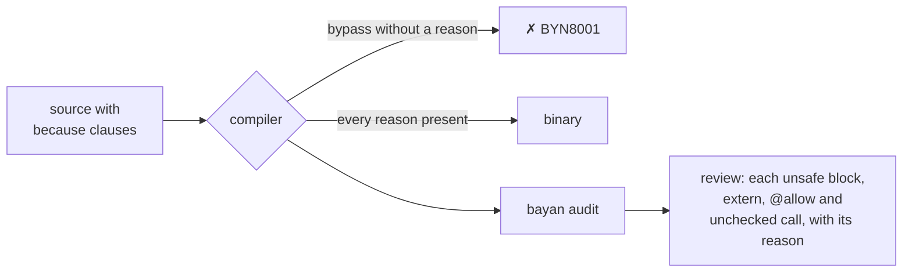

*Reasons are collected, not lost. `bayan audit` lists every bypass with its reason.*

```text
$ bayan audit
src/db/sqlite.byn:41  unsafe     sqlite3_open writes the handle through its out parameter
src/cli/flags.byn:12  @allow     BYN5102: mirrors the flag name in the C header
src/web/auth.byn:88   unchecked  trustUnchecked: HMAC checked by the gateway
3 bypasses, 3 reasons
```

*Output layout is illustrative.*

## What the compiler checks

| Code | When it fires | Message |
|---|---|---|
| BYN1052 | `except` given a condition | `except` takes a pattern, not a condition |
| BYN1051 | `except` inside a `case` | `except` is not allowed in a `case` pattern (fix: `case not .x`) |
| BYN8001 | A bypass with no reason | `trustUnchecked` bypasses a safety rule and needs `because "…"` |

**Status:** `because` `built` · `except` on error sets `built`, on sequences `partial` (parsed, binding in progress)

> **Takeaway.** Say what you subtract and say why you bypass. `except` makes exclusion a pattern the compiler can narrow; `because` makes every exception to safety a reviewable line of the program.

# Axiom IV: The cadence of execution

> **وَقْف** · *waqf* · pausing: where a reciter must stop, may stop, or must keep going

> Semicolons are a leftover from parsers that could not read lines. Bayān has none. A newline ends a statement, a short fixed list of marks keeps it open, and any line the compiler would misread becomes an error instead of a surprise.

## The idea, without Arabic

When the Qurʾān is recited, small marks above the text tell the reciter how to breathe. One mark means *you must stop here*. Another means *do not stop here*, because stopping would change the meaning. Others say that joining the next words is better. The marks exist for one reason: so that the same text is always read with the same meaning.

Bayān's parser follows three of these ideas:

| Mark | Name | Meaning in recitation | Rule in Bayān |
|---|---|---|---|
| مـ | *lāzim* | Mandatory stop | A newline after a complete statement ends it |
| لا | *lā* | Do not stop | The line ends with a binary operator, `,`, `=`, `=>` or `{`, or is inside `( )` or `[ ]`: keep going |
| وصل | *waṣl* | Join with what follows | The next line starts with `.`, `?.`, `??`, `except`, `where`, `requires`, `expects`, `uses`, `becomes`, `fails`, `catch`, `&&`, `\|\|`, `and` or `or`: it continues the statement |

And one rule of its own: a line starting with `(`, `[` or `-` **never** joins the line above.

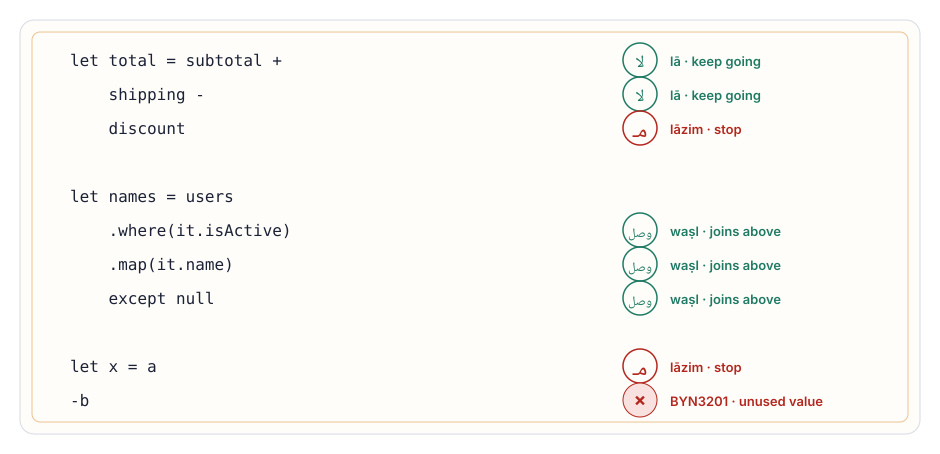

## The problem elsewhere

Languages without semicolons usually insert them for you, and the insertion rules have sharp edges.

*JavaScript*

```javascript
function total() {
  return
    subtotal + shipping   // ';' inserted after return: returns undefined
}

const a = b
(c || d).run()            // no ';' inserted: parsed as b(c || d).run()
```

*Go*

```go
total := subtotal +
    shipping              // operator at the end: continues

order := cart.
    Checkout()            // the dot must end the line;
                          // a leading dot is a syntax error
```

*Python*

```python
total = (subtotal
         + shipping)       # continuation only inside brackets
total = subtotal \
        + shipping         # or with a trailing backslash
```

JavaScript's bugs are silent: both examples run, and do the wrong thing. Go and Python are safe but force the break into a less readable place.

## The Bayān way

*Bayān*

```csharp
let total = subtotal +           // لا  ends with an operator: keep going
    shipping -
    discount

let names = users
    .where(it.isActive)          // وصل  a leading '.' joins the line above
    .map(it.name)
    except null                  // وصل  so does `except`

public Order.shipped ship(move Order.paid order, by Carrier carrier)
    uses net                     // وصل  signature clauses join
    fails CarrierError { … }
```

The safety net is a second rule: **an unused value is a compile error.** If a line is split where it should not be, the stray half is a value nobody uses, and the compiler says so.

*Bayān (rejected by the compiler)*

```csharp
let x = a                        // مـ  complete: the statement ends here
-b                               // ✗ BYN3201: this value is unused
```

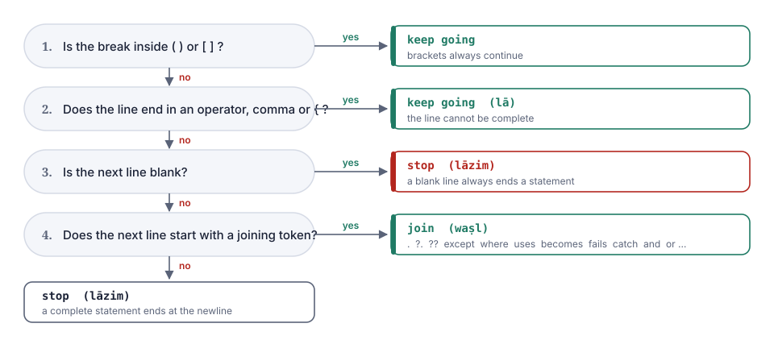

A few more rules keep lines honest:

- `return`, `break`, `continue` and `fail` take their operand on the same line, so the JavaScript `return` trap cannot happen.
- `else` follows `}` on the same line.
- A postfix `if` or `unless` sits on its statement's line: `return .notFound unless found`.
- A blank line always ends a statement (outside brackets).
- A joining line must be indented deeper than its statement; `bayan format` fixes it if not.
- A struct literal in a condition takes parentheses, so `{` never has two meanings: `if (p is { x: 0, y: 0 }) { … }`.

## What the compiler checks

| Code | When it fires | Message |
|---|---|---|
| BYN1040 | A `;` in source | `;` is an input form; a statement ends at the newline |
| BYN3201 | A mis-split line leaves a value unused | the value of this expression is unused |
| BYN1041 | `else` on a new line | `else` must follow `}` on the same line |
| BYN1042 | An operand or modifier on the next line | `return` takes its value on the same line |

**Status:** Newline termination and waqf rules `built`

> **Takeaway.** Bayān reads code the way a trained reciter reads a marked page: the same text, the same meaning, every time. Where a line break could be misread, the compiler stops you instead of guessing.

# Axiom V: Roles, not positions

> **حُرُوفُ الجَرّ** · *ḥurūf al-jarr* · the prepositions: small words that give a noun its role

> `copy(a, b)`: which one is the source? Every language has a function where swapping two arguments compiles, runs, and quietly destroys data. In Bayān, arguments carry their role, and a call reads as the sentence it is.

## The idea, without Arabic

In Arabic, a noun's role in a sentence is shown by small particles in front of it: مِن *min* (from), إلى *ilā* (to), بِ *bi* (by, with). Because the particle carries the role, the phrases can move without changing the meaning:

> سافرتُ مِن دمشقَ إلى القاهرةِ بالقطار · "I travelled **from** Damascus **to** Cairo **by** train"

Bayān has a **closed set of eight particles**. The object of the call takes none; every other required parameter takes one, and every call writes it.

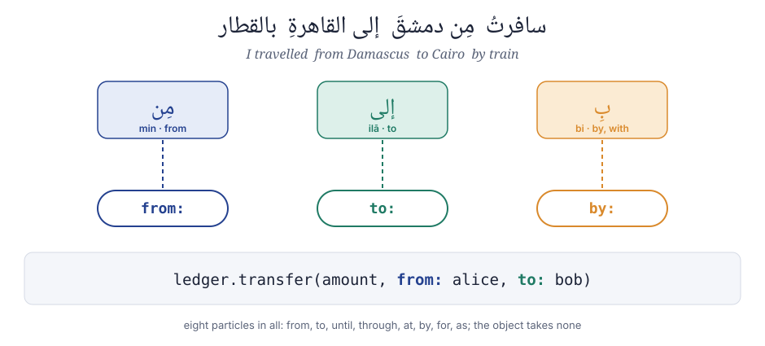

| Particle | Role | Example |
|---|---|---|
| *(none)* | The object acted on | `lines.insert(x, at: 3)` (here `x`) |
| `from` | Source or start | `copy(from: a, to: b)` |
| `to` | Destination or recipient | `print(p, to: .stderr)` |
| `until` | Exclusive end | `xs.remove(from: 2, until: 5)` |
| `through` | Inclusive end | `xs.remove(from: 2, through: 4)` |
| `at` | Position or time | `FakeClock(at: date)` |
| `by` | Means, or replacement | `ship(order, by: carrier)` |
| `for` | Beneficiary or purpose | `price.format(for: locale)` |
| `as` | Role | `log(msg, as: .debug)` |

## The problem elsewhere

*C*

```c
memcpy(dst, src, n);      // C: destination first
```

*Go*

```go
copy(dst, src)            // Go: destination first
```

*Shell*

```bash
cp src dst                # the shell: source first
```

*C#*

```csharp
File.Copy(source, dest);              // source first
Transfer(alice, bob, amount);         // who pays whom?
Transfer(payer: alice, payee: bob, amount: amount);  // names are optional
```

*Swift*

```swift
transfer(amount, from: aisha, to: bilal)
// Swift has labels: free-form, chosen per API,
// so every library invents its own vocabulary
```

Swift showed that labels make calls readable. Bayān keeps the readability and adds two things: the vocabulary is **closed** (eight words, the same everywhere), and it is **mandatory** for required parameters.

## The Bayān way

*Bayān*

```csharp
public void copy(from Path src, to Path dst) uses fs fails FsError
public void transfer(Money amount, from Account payer, to Account payee)
    fails LedgerError
public void insert(ref this, T item, at Index i) uses alloc
public void remove(ref this, from Index start, until Index end)

copy(from: a, to: b)
try ledger.transfer(amount, from: aisha, to: bilal)
lines.insert(x, at: 3)
xs.remove(from: 2, until: 5)
```

*Bayān (rejected by the compiler)*

```csharp
copy(a, b)                       // ✗ BYN5005: `a` needs its particle `from:`
ledger.transfer(amount, aisha, bilal)
```

The rules are short:

- A function has at most one unlabeled parameter, the object. The receiver (`this`) does not count.
- A particle appears at most once per signature. If you need two sources, group them in a struct.
- The particles are part of the function's name: `copy(from:to:)` and `move(_, by:)` are different functions.
- A `bool` parameter is always passed by name, so `save(true)` never appears.
- Particle words are never member names: there is no `xs.at(3)`, no `toList()`, no `asSpan()`. A view is a noun (`xs.span`), a copy is `copy()`, a conversion is `T(x)`.
- Optional parameters use a particle when one fits (`log(m, as: .debug)`), otherwise their name (`timeout: 5s`).

## What the compiler checks

| Code | When it fires | Message |
|---|---|---|
| BYN5004 | Two unlabeled parameters | `copy` has 2 unlabeled parameters; give each but one a particle |
| BYN5005 | A call omits a particle | `a` is passed without its particle `from:` |
| BYN5008 | A label that is not a particle | `into` is not a particle |
| BYN5009 | A member named with a particle | `at` is a particle; name the member with a verb or a noun |
| BYN5013 | A particle used twice | `merge` uses the particle `from` twice |

**Status:** Argument particles `built`

> **Takeaway.** Positions are easy to swap; roles are not. Eight particles, the same in every library, make each call read as a sentence and turn swapped arguments into compile errors.

# Axiom VI: Head first

> **الحال** · *taqdīm, ḥāl* · the head comes first; the circumstance follows it

> Say what something is before you say how it is. A declaration starts with its kind, a statement starts with its verb, and modifiers follow. One order, everywhere, so the first word of a line always tells you what the line is.

## The idea, without Arabic

Arabic puts the head of a phrase before what modifies it. An adjective follows its noun, so "a big book" is كتابٌ كبيرٌ *kitābun kabīrun*, literally "book big".

A verb can be followed by a *ḥāl*, a participle that describes the circumstance in which the act happens:

> جاءَ زيدٌ راكبًا · *jāʾa Zaydun rākiban* · "Zayd came, riding"

The verb comes first. The circumstance follows it and narrows it.

Bayān borrows the **order**, not the language: code still reads left to right in English. It just always puts the head first.

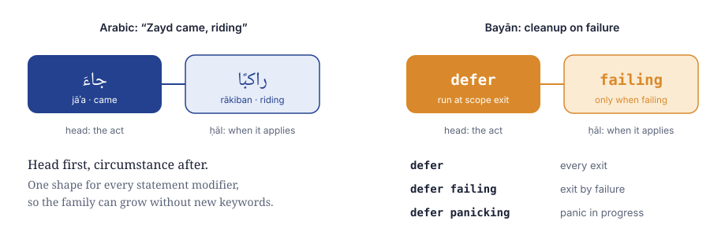

## Head-first declarations

The kind of thing comes first; what makes it special follows.

| Familiar order | Bayān | Meaning |
|---|---|---|
| `unique struct File` | `struct unique File` | A move-only struct |
| `distinct type UserId` | `type distinct UserId = i64` | A new type, not an alias |
| `error union ParseError` | `union error ParseError` | A union used as an error set |

The familiar spellings still work in your editor: `bayan format` rewrites them, and the compiler explains the canonical form (BYN1044).

## Head-first statements: the `defer` family

Cleanup is where the *ḥāl* earns its place. `defer` is the head verb. A participle after it says **under which circumstance** the cleanup runs.

*Bayān*

```csharp
var arena = Arena()
defer arena.reset()                           // on every exit
var tx = try db.begin()
defer failing tx.rollback()                   // only if this function exits by failing
defer panicking (p) log($"{p}", as: .error)   // only while a panic is in progress

try tx.insert(order)
try tx.commit()
```

Compare the same "roll back on failure" in other languages:

*Zig*

```zig
const tx = try db.begin();
errdefer tx.rollback();     // Zig's errdefer: Bayān's direct ancestor
try tx.insert(order);
try tx.commit();
```

*Go*

```go
func save(order Order) (err error) {
    tx, err := db.Begin()
    if err != nil { return err }
    defer func() {
        if err != nil { tx.Rollback() }   // relies on a named result
    }()
    // ...
}
```

*C#*

```csharp
using var tx = db.BeginTransaction();
try {
    Insert(tx, order);
    tx.Commit();
} catch {
    tx.Rollback();
    throw;
}
```

Zig's `errdefer` gets the idea right with a new keyword. Bayān makes it a **family** with one shape: head verb, then participle. A future cleanup modifier must follow the same shape, so the language grows without inventing new words.

## Rules that keep `defer` safe

- Deferred statements run in reverse order of registration.
- A deferred body **cannot fail** (no `try` inside), so cleanup cannot start a second failure.
- `defer failing` is allowed only in a function that `fails`.
- A panic aborts without unwinding: only `defer panicking` handlers run, then the process-wide `Panic.handler`, then the trace.
- A postfix modifier on a defer is evaluated when the defer is **registered**: in `defer failing tx.rollback() unless dryRun`, a later change to `dryRun` has no effect.

## Where names lead

Local bindings put the **name** first and the type after it, because a binding introduces a name. Declarations put the **type** first, because a signature is a contract about types.

*Bayān*

```csharp
let w: Grams = 0g                 // binding: name first
var total: Money = Money.zero(currency)

Grams weight(Order order) { … }   // declaration: type first
struct Parcel {
    Grams weight                  // field: type first
}
```

## What the compiler checks

| Code | When it fires | Message |
|---|---|---|
| BYN1044 | A modifier before its head | `unique struct` is an input form; write `struct unique` |
| BYN1020 | `errdefer` from Zig habit | `errdefer` is now `defer failing` |
| BYN2606 | `defer failing` where nothing can fail | `defer failing` in a function that cannot fail |
| BYN2601 | `try` inside a deferred body | `try` is not allowed in `defer` |

**Status:** Head-first declarations `built` · `defer`, `defer failing`, `defer panicking` `built`

> **Takeaway.** The first word tells you what the line is; the next word tells you when it applies. Head first, circumstance after: one order that every new feature must follow.

# Axiom VII: One spelling, free composition

> **إعجام · حذف** · *iʿjām, ḥadhf* · adding dots to remove ambiguity; leaving out what context supplies

> A language with three ways to write a null check makes every reader learn all three. Bayān has one spelling per construct. It does not limit what you can say, only how many ways there are to spell the same word.

## The idea, without Arabic

Early Arabic script used one shape for several letters. The shape ٮ could be read as *b*, *t*, *th*, *n* or *y*. Readers who already knew the text were fine; everyone else had to guess. In the first century of Islam, scholars added dots, *iʿjām*, so that every letter had one reading.

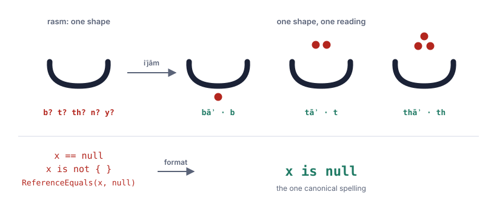

Arabic rhetoric also prizes *ḥadhf*, ellipsis: leaving out what context makes obvious. Asked "who came?", you answer "Zayd", and "came" is understood.

Bayān keeps both: **no synonyms** (iʿjām), and **ellipsis where context recovers the meaning** (ḥadhf).

## Three kinds of "same meaning"

| Kind | Example | Bayān's rule |
|---|---|---|
| **Synonym**: two spellings of one construct | `x == null` and `x is null` | Rejected. One is the written form; the other is an input form the formatter rewrites |
| **Paraphrase**: different sentences from the same grammar | `users except null` and `users.where(it is not null)` | Allowed, if truly equivalent in narrowing, cost and effects |
| **Ellipsis**: a part the context recovers | `it`, inferred types, `.paid` for `Order.paid` | Allowed |

## Input forms: your habits still work

You may type habits from other languages in your editor. `bayan format` rewrites them; the compiler explains the preferred form with a machine-applicable fix. You are taught, not punished.

| You type | Bayān writes | Code |
|---|---|---|
| `x != null` | `x is not null` | BYN2027 |
| `foreach (var x in xs)` | `for x in xs` | BYN1019 |
| `if (ready) {` | `if ready {` | BYN1017 |
| `/* … */` | `//` lines | BYN1047 |
| `"Salam " + name` | `$"Salam {name}"` | BYN2209 |
| `(u8)x` | `u8(x)` | BYN1057 |
| `User!EmailError f()` | `User f() fails EmailError` | BYN1031 |
| `errdefer` | `defer failing` | BYN1020 |
| `[Derive(Json)]` | `@derive(Json)` | BYN1045 |
| `params T[] items` | `rest ReadOnlySpan<T> items` | BYN1058 |
| `toString()` | `format()`, or `string(x)` | BYN2031 |
| trailing `;` | a newline | BYN1040 |

## How other languages handle this

*C#*

```csharp
if (x == null) { }
if (x is null) { }
if (ReferenceEquals(x, null)) { }
if (x is not { }) { }
// four null checks; == can be overloaded, so they can differ
```

*Python*

```python
# The Zen of Python: "There should be one--
# and preferably only one --obvious way to do it."
# A guideline for people; the language does not enforce it.
```

## Two exceptions, on purpose

Bayān admits two synonym pairs. Each is a closed set of tokens, identical in meaning and cost, and **chosen once per project** in `package.byn`, then normalized by the formatter:

*Bayān*

```csharp
style: Style {
    booleans: .words,        // not, and, or     (or .symbols: !, &&, ||)
    primitives: .sized,      // i32, i64         (or .csharp: int, long)
},
```

Inside one project there is still one spelling. No third pair qualifies, and the bar for adding one is written down.

## Ellipsis in practice

*Bayān*

```csharp
let names = users.map(it.name)                // `it`: the lambda's one parameter
let open = orders.where(it is .placed)        // `.placed`: the type is known
let w = 0g                                    // the type comes from the literal
let order = db.find(id) ?? return .notFound   // the error case is target-typed
```

## What the compiler checks

Every input form in the table above has its own code and its own fix. Display-only views, such as inferred types and effects, appear as editor inlay hints and are never stored as an alternative spelling.

**Status:** Input forms with fix-its `built` · per-project `style` normalization by `bayan format` `planned`

> **Takeaway.** One spelling per construct means one thing to learn and one thing to search for. Say anything you like, in any sentence the grammar allows; just spell each word one way.

# Axiom VIII: Nothing hidden

> **بَيان** · *bayān* · clarity: the language's own name

> A function signature is a contract. In Bayān it states what the function needs, what it touches, what it leaves behind, and how it can fail. If a call can allocate, wait on the network or fail, you can see it without opening the body.

## The idea

This axiom has no grammar rule behind it; it is the meaning of the name. *Bayān* means clarity, a statement that leaves nothing unexplained. The first principle of the language says the same in engineering terms: **performance is a feature, so there are no hidden costs.** Allocation, suspension and failure are always visible in the source or the tooling.

## Reading a signature

Signature clauses come in one fixed order: the order in which each one applies.

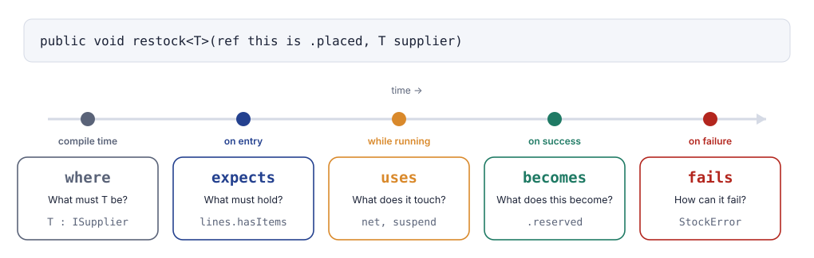

*Bayān*

```csharp
public void restock<T>(ref this is .placed, T supplier)
    where T : ISupplier         // compile time: what T must be
    expects lines.hasItems      // on entry: what must hold
    uses net, suspend           // while running: what it touches
    becomes .reserved           // on success: what this becomes
    fails StockError            // on failure: how it fails
```

## Effects: the `uses` clause

One closed list covers allocation, waiting and every kind of outside access:

| Effect | Covers |
|---|---|
| `alloc` | Heap allocation |
| `suspend` | Parking the current fiber while it waits |
| `net` | Any socket, pipe or network access |
| `fs` | Files and directories |
| `clock` | Reading the time |
| `random` | Randomness |
| `env` | Environment variables and process-wide settings |
| `process` | Starting and controlling other processes |
| `console` | stdin, stdout, stderr |

**No `uses` clause means pure.** A function without one cannot allocate, block, or touch the outside world. Logging is the one ambient exception: it never allocates and can be intercepted.

*Bayān*

```csharp
public u32 crc(ReadOnlySpan<u8> data) { … }      // pure: no I/O, no allocation

public ParcelId book(Parcel parcel, by Carrier carrier)
    uses net, alloc, suspend fails CarrierError
{ … }

public List<U> map<U>((T -> U) f) uses alloc     // f's effects pass through
let names = users.map(it.fetchName())            // so this call also uses net
```

That last rule removes a whole family of duplicates. There is no `tryMap`, no `mapAsync`: `map` takes the effects of whatever you pass it.

## Effects are also security

A package declares its capabilities in `package.byn`. A package without `.net` cannot contain any function that uses the network, however deep the call chain. A dependency update that adds a capability shows up in the lockfile diff.

*Bayān*

```csharp
capabilities: [.fs]      // this package may touch files; nothing else
```

## Swapping effects in tests

Effects are handled with `provide`. Handlers compile to context passing, so they cost nothing at run time.

*Bayān*

```csharp
let net = FakeNet(label)
provide net: net, clock: FakeClock(at: Date(year: 2026, month: 12, day: 1)) {
    try shipAll(order, by: carrier)
}
assert net.calls == 1
```

## Errors: the `fails` clause

There are no exceptions. A public function lists the errors it can fail with; each call that can fail is marked with `try`.

*Bayān*

```csharp
let resp = signUp(form) catch switch {
    EmailError      => .badRequest("Invalid email"),
    DbError.timeout => .unavailable,
    DbError e       => .serverError(e),
}
```

`return` always returns a value; `fail .x` always leaves with an error. They can never be confused.

## The same contract in other languages

*C#*

```csharp
public async Task<Order> ShipAsync(Order order)
// may throw anything, may allocate, may do I/O;
// async is visible, but it colors every caller
```

*Rust*

```rust
async fn ship(order: Order) -> Result<Order, CarrierError>
// errors are visible; allocation and I/O are not
```

*Zig*

```zig
fn ship(alloc: Allocator, order: Order) !Order
// allocation by convention (an allocator parameter);
// the error set can be inferred
```

*Swift*

```swift
func ship(_ order: Order) async throws(CarrierError) -> Order
// typed throws (Swift 6) and async; no allocation or I/O info
```

*Koka*

```koka
fun ship(order : order) : <exn,io> order
// Koka tracks effects in the type: Bayān's closest relative
```

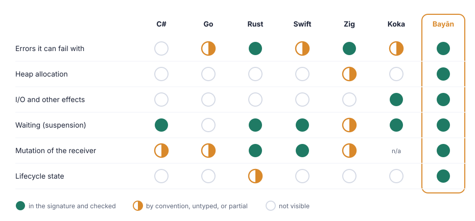

## What the compiler checks

| Code | When it fires | Message |
|---|---|---|
| BYN6002 | A function uses an effect it does not declare | `book` uses `net` but does not declare it |
| BYN6003 | An unknown effect name | `db2` is not an effect |
| BYN6004 | A package exceeds its capabilities | `fetch` uses `net`, which package `acme/report` does not declare in `capabilities` |
| BYN6005 | An implementation exceeds a declared bound | `price` uses `fs`, beyond the bound `net, alloc` declared by `IPricer` |
| BYN2603 | Failing with an undeclared error | `.timeout` is not in the `fails` clause of `handle` |
| BYN1065 | Clauses out of order | `uses` must come before `fails`; the order is `where`, `expects`, `uses`, `becomes`, `fails` |

**Status:** `uses` and effect checking `built` · `fails`, `try`, `catch` `built` · `provide` `partial` (the `alloc` handler today; others coming)

> **Takeaway.** Read the signature, know the cost. No `uses` means pure; `uses alloc` means it allocates; `fails` lists every way it can go wrong. The body cannot do more than the signature says.

# Axiom IX: Valid by construction

> **صِحّة** · *ṣiḥḥa* · soundness: a value that exists is a valid value

> Validation that someone has to remember to call will eventually not be called. In Bayān the rules live in the type and run when the value is built. If you hold a value, it is valid, and that is the only way untrusted input becomes trusted.

## The idea

This axiom is Bayān's own; the Arabic word on the opener simply names it. It follows from a principle the specification states outright: **memory safety is never a build-mode option.** Bounds checks, region checks and validation run in every build, debug or release.

## Rules on the type: `requires`

*Bayān*

```csharp
type distinct Email = string requires it.isEmailShaped

@derive(Json)
struct SignupForm {
    Email email
    string username
        requires it.runeCount in 3..=32
        requires it.isAsciiAlphanumeric
    string password
        requires it.runeCount in 8..=128
    i32 age
        requires it in 13..=120

    requires password != username  at .password
}
```

- A literal of a type with `requires` is fallible: `let form = try SignupForm { … }`.
- **Every** violation is collected and reported, not just the first. Each is structured data (field, rule) with no message string, so a web framework can localize it.
- Fields of such a type cannot be assigned one at a time; updates go through `with`, which re-checks: `try form with { password: p }`.
- The rules are also exposed as data (`SignupForm.rules`), so a web framework can emit matching HTML form attributes from the same source.

*C#*

```csharp
public class SignupForm {
    [Range(13, 120)] public int Age { get; set; }
}
var f = new SignupForm { Age = 7 };   // perfectly legal
// valid only if someone remembers to run a validator
```

*Rust*

```rust
pub struct Email(String);              // private field
impl Email {
    pub fn parse(s: &str) -> Result<Email, EmailError> { /* … */ }
}
// the newtype pattern: sound, but hand-written for every type
```

Rust's newtype pattern gets the guarantee by discipline. Bayān makes it the default: one line per rule, checked at construction.

## Units: numbers that know what they measure

*Bayān*

```csharp
unit Seconds(s): i64
unit Millis(ms) = Seconds / 1000
unit Grams(g): i64
unit Kilograms(kg) = 1000 g
unit Minutes(min) = 60 s

let timeout = 2s + 500ms              // Millis 2500: finer is implicit
let billed: Minutes = talk.ceiling()  // coarser: name the rounding
let w: Grams = 0                      // ✗ a bare number has no unit: write 0g
```

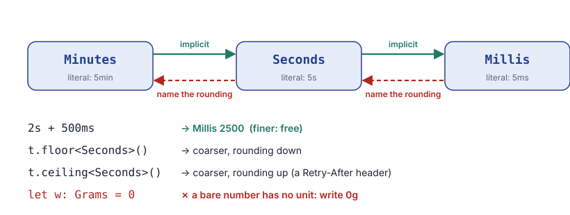

F# pioneered units of measure in a mainstream language; Bayān adds the rounding rule, so precision is never lost silently. Units are erased at run time: `Seconds` is an `i64` in the binary.

## Trust: two layers

**Layer 1: sinks take types, not strings.** A database call takes `Sql`, a page takes `Html`, a file path segment takes `PathSegment`. A plain `string` does not fit, whatever its origin, so injection is a type error.

*Bayān*

```csharp
let users = try db.query<User>(sql"SELECT * FROM users WHERE name = $1", term).all()
let page = Html.escape(name)
```

**Layer 2: `Untrusted<T>` for values from outside.** Request bodies, headers, command-line arguments and stdin arrive as `Untrusted<T>`. Every operation on one returns another `Untrusted`. Filtering keeps the taint. **Only constructing a type with `requires` removes it.**

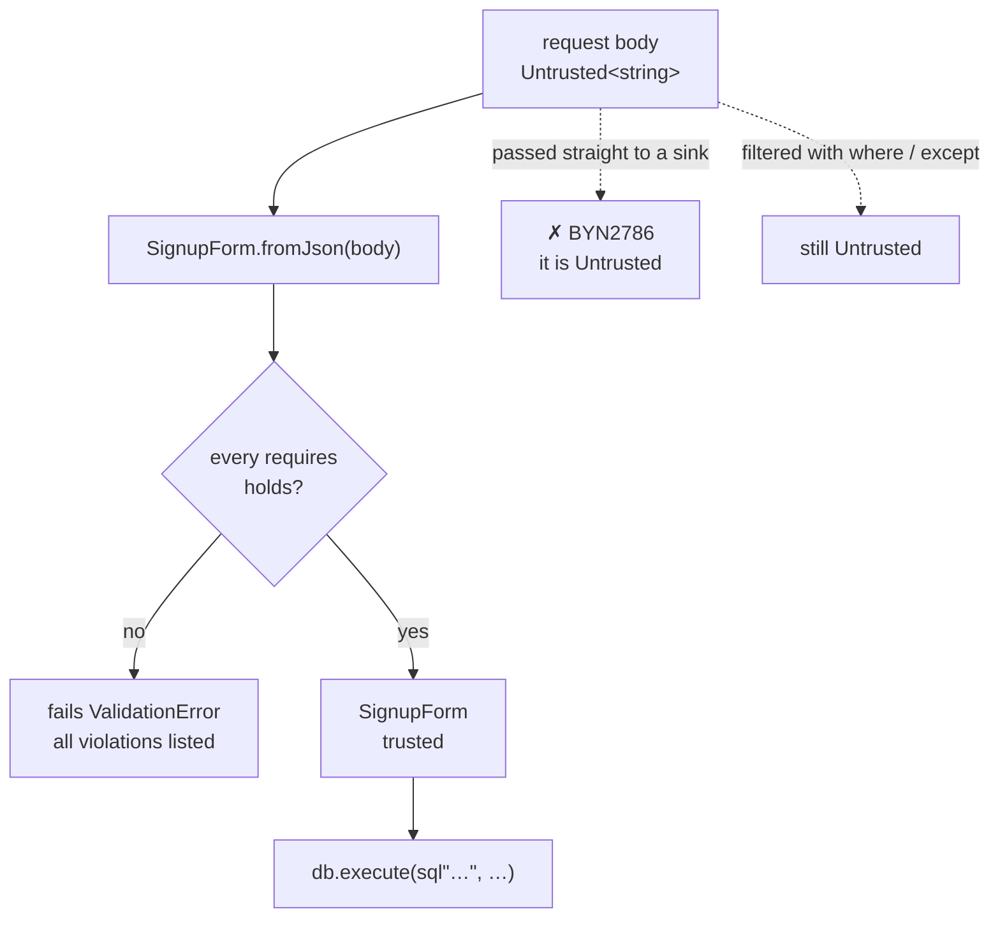

*How outside data becomes trusted. The only door is construction of a type whose rules hold.*

## Secrets

`Secret<T>` values print as `***` in logs, debug output and every derivation. They have no `==` (only `equalsConstantTime`), and they are zeroed when dropped. Exposing one to JSON is a bypass, so it takes a reason: `@json(expose) because "…"`.

## What the compiler checks

| Code | When it fires | Message |
|---|---|---|
| BYN3207 | Building a checked type without `try` | a literal of `SignupForm` can fail its `requires`; write `try SignupForm { … }` |
| BYN3208 | Assigning one checked field | fields of `SignupForm` cannot be assigned one at a time |
| BYN3218 | A rule mixing `it` and other fields | this `requires` reads `it` and other fields |
| BYN2786 | Untrusted data reaching a process sink | `arg` cannot be passed to `run`: it is `Untrusted` |
| BYN8006 | A precondition reading untrusted data | `expects` reads `body`, which is `Untrusted` |

**Status:** `requires`, `expects`, `Untrusted<T>`, `distinct` types `built` · units `planned` · sink types and `Secret<T>` are specified; their compiler status was not verified for this edition

> **Takeaway.** Don't validate values; build them. A rule written once on the type holds everywhere the type goes, and construction is the one door from untrusted to trusted.

# Axiom X: The hoopoe's voice

> **الهُدْهُد** · *al-hudhud* · the hoopoe, who brings certain news

> A compiler is a teacher you talk to dozens of times an hour. Bayān's diagnostics say what went wrong, where, why, and how to fix it, in plain English, with a fix your editor can apply.

## The idea

In Sūrat an-Naml (27:20–22), Solomon reviews the birds and finds the hoopoe missing. When it returns, it does not apologize or speculate. It reports what it saw, and says it brings news that is بِنَبَإٍ يَقِين *bi-nabaʾin yaqīn*, "certain". The hoopoe is Bayān's mascot, and its report is the model for every compiler message: exact, located, explained, actionable.


## Anatomy of a diagnostic

```text
error[BYN6002]: `book` uses `net` but does not declare it
  --> src/shipping/book.byn:14:20
   |
14 |     let resp = try carrier.post(label)
   |                    ^^^^^^^^^^^^^^^^^^^ this call uses `net`
   |
   = why: a public signature lists its effects, so callers can see them
   = fix: add `uses net` to the signature of `book`
```

*Layout is illustrative; the message text is the compiler's.*

| Part | Answers | In the example |
|---|---|---|
| Code | Which rule | `BYN6002`, explained offline by `bayan explain BYN6002` |
| Message | What | `book` uses `net` but does not declare it |
| Span | Where | file, line, column, underline |
| Why | Why the rule exists | callers must see effects |
| Fix | How to fix | machine-applicable when possible |

Rules drawn from Arabic grammar are phrased without Arabic: "nouns name values, verbs name actions; `get` adds nothing here". The Arabic source of a rule appears only in `bayan explain`, under "Where this comes from", for those who want it.

## Teaching errors

When you type a habit from another language, the compiler recognizes it and teaches the Bayān form instead of reporting a confusing parse error:

```text
error[BYN1020]: `errdefer` is now `defer failing`
error[BYN1019]: `for (let x in xs)` is an input form; write `for x in xs`
error[BYN2209]: strings cannot be joined with `+`; use interpolation
```

## For tools

`bayan check`, `build`, `run` and `test` accept `--diagnostics json`: one JSON object per line with `code`, `severity`, `file`, `span`, `message`, `label`, `help` and `fixes`. Editors and AI assistants get the same certainty a person does.

## How many rules does the compiler enforce?

At the commit this book was written against, the compiler emits **314 live diagnostics**. Codes are grouped by thousands into areas, the way HTTP status codes are grouped by hundreds. (A tidier renumbering is planned; the counts below use today's numbers.)

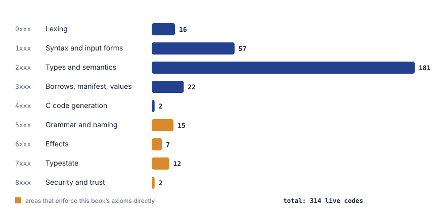

**Status:** Plain-English diagnostics with codes, explain pages and fixes `built` · JSON output and `bayan audit` are specified for the toolchain

> **Takeaway.** The compiler is the hoopoe: it was where you were not looking, and it comes back with certain news. What, where, why, and how to fix it, every time.

# Epilogue: joy is a requirement

The ten axioms rest on twelve working principles from the specification. They are the tests every new feature must pass:

1. **Performance is a feature.** No hidden costs.
2. **Every keystroke carries meaning.** If the compiler can infer it, don't type it.
3. **Brief but complete.** One spelling per construct; free composition.
4. **Predictable.** Roots plus a closed set of patterns.
5. **Elegant by default.** One formatter, one form.
6. **Kind to the programmer.** Errors explain what, where, why and how to fix.
7. **Instant feedback.** REPL, scripts and incremental builds under 100 ms.
8. **Joy is a requirement.**
9. **Memory safety is never a build-mode option.**
10. **Promise as little as possible.** Anything specified precisely is permanent.
11. **Bayān follows its own principles.** Familiarity from other languages is a benefit, never a deciding reason.
12. **Head-first word order.** The head comes first; modifiers follow.

The point of all of it is the eighth. A language whose names keep their promises, whose lines mean one thing, and whose compiler speaks plainly is a language that is a pleasure to write. That is what *bayān* means.

# Appendix A: glossary

| Term | Arabic | Say it | Literal meaning | In Bayān |
|---|---|---|---|---|
| bayān | بيان | ba-YAAN | clarity, eloquent exposition | the language |
| ṣarf | صرف | SARF | morphology | naming patterns (Axiom I) |
| ishtiqāq | اشتقاق | ish-ti-QAAQ | derivation | derived forms such as `tryX` |
| wazn | وزن | WAZN | measure, pattern | one naming pattern |
| mafʿūl | مفعول | maf-OOL | that which is acted on | `-ed` copies: `sorted()` |
| fāʿil | فاعل | FAA-il | doer | `Parser`, `Builder` |
| maṣdar | مصدر | MAS-dar | verbal noun | `xOp` |
| kāna | كان | KAA-na | was | typestate (Axiom II) |
| ṣāra | صار | SAA-ra | became | `becomes`, `become` |
| istithnāʾ | استثناء | is-tith-NAA | exception | `except` (Axiom III) |
| mafʿūl li-ajlihi | مفعول لأجله | maf-OOL li-AJ-li-hi | object of purpose | `because` |
| waqf | وقف | WAQF | pausing | newline rules (Axiom IV) |
| waṣl | وصل | WASL | joining | continuation lines |
| ḥurūf al-jarr | حروف الجر | hu-ROOF al-JARR | prepositions | particles (Axiom V) |
| ḥāl | حال | HAAL | circumstance | `defer failing` (Axiom VI) |
| iʿjām | إعجام | iʿ-JAAM | adding dots | one spelling (Axiom VII) |
| ḥadhf | حذف | HADHF | ellipsis | `it`, `.member`, inference |
| hudhud | هدهد | HUD-hud | hoopoe | the mascot; error voice (Axiom X) |

# Appendix B: cheat sheet

| Task | Bayān | C# | Rust |
|---|---|---|---|
| Immutable binding | `let n = 3` | none (`const` is compile-time only) | `let n = 3;` |
| Mutable binding | `var n = 3` | `var n = 3;` | `let mut n = 3;` |
| Condition | `if n > 0 { … }` | `if (n > 0) { … }` | `if n > 0 { … }` |
| Loop | `for x in xs { … }` | `foreach (var x in xs)` | `for x in &xs { … }` |
| Null check | `x is not null` | `x is not null` | `x.is_some()` |
| Early exit on null | `let u = find(id) ?? return .notFound` | `if (u is null) return …;` | `let Some(u) = find(id) else { return … };` |
| Fallible call | `let p = try parse(s)` | `var p = Parse(s);` (throws) | `let p = parse(s)?;` |
| Handle errors | `f() catch switch { … }` | `try { } catch (E e) { }` | `match f() { Err(e) => … }` |
| Mutating method | `void add(ref this, Line l)` | `void Add(Line l)` | `fn add(&mut self, l: Line)` |
| Changed copy | `xs.sorted()` | `xs.OrderBy(x => x)` | clone, then `sort()` |
| Cleanup on failure | `defer failing tx.rollback()` | `catch { tx.Rollback(); throw; }` | a guard with `Drop` |
| String building | `$"total {x}"` | `$"total {x}"` | `format!("total {x}")` |
| Effects | `uses net, alloc` | none | none |
| State in type | `Order.paid` | none | `Order<Paid>` (pattern) |

# Appendix C: status at the time of writing

Written against the specification snapshot at commit `8d5e5c71` (9 November 2026, revisions 0001 to 0019) and the compiler line that shipped as 0.2.0.

| Feature | Axiom | Status |
|---|---|---|
| Naming pattern checks (`-ed`, `tryX`, `is`/`has`/`can`) | I | `built` |
| Automatic derivation of `tryX`, `x()` from `xInto`, `xOp` | I | `partial` |
| Typestate: `states`, `becomes`, `become`, `T.s` | II | `built` |
| `except` on error sets / on sequences | III | `built` / `partial` |
| `because` and BYN8001 | III | `built` |
| Newline termination and waqf rules | IV | `built` |
| Argument particles | V | `built` |
| Head-first declarations, `defer` family | VI | `built` |
| Input forms with fix-its | VII | `built` |
| Per-project `style` normalization | VII | `planned` |
| `uses` effects, capabilities | VIII | `built` |
| `provide` handlers | VIII | `partial` |
| `requires`, `expects`, `Untrusted<T>` | IX | `built` |
| Units of measure | IX | `planned` |
| Diagnostics with codes and fixes | X | `built` |

# Appendix D: from the first draft to this edition

The first draft of this manifesto proposed four axioms with sketch syntax. The specification has since settled each one. For readers of the draft:

| Draft sketch | Settled form | Why |
|---|---|---|
| A `root` keyword declares a root | Every type is a root; no keyword | Roots are open, patterns are closed: nothing to declare |
| `processInto()` "writes to target" | `xInto(ref dst)` writes into the caller's buffer; `x()` is derived from it and adds `uses alloc` | The allocation becomes visible |
| `processed()` "a pure, untouched copy" | `xed()` is a view if possible, otherwise a copy | Copying is a cost; a view is free |
| `void authorize(ref this is .draft) becomes .authorized` | The same idea, with clauses in a fixed order: `where`, `expects`, `uses`, `becomes`, `fails` | One order, by when each clause applies |
| Leading `.` keeps a statement open | Kept, plus `except`, `where`, `uses`, `fails`, `catch`, `and`, `or` and others; lines ending in an operator continue; `(`, `[`, `-` never join | Every mis-split line becomes BYN3201 |
| `because` on raw pointer reads, exported as JSON | `because` on four kinds of bypass; `bayan audit` lists them all | One mechanism for every bypass |
| Four axioms | Ten axioms | Particles, head-first order, one spelling, effects, validation and diagnostics were settled after the draft |
